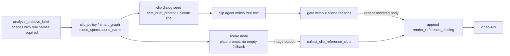
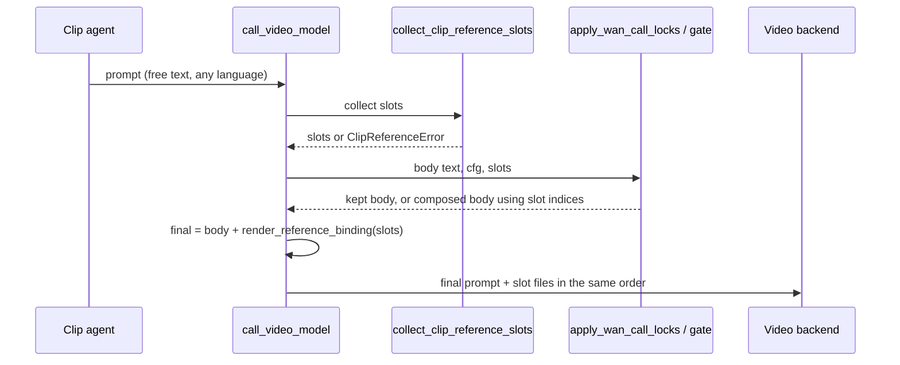

# Code-rendered scene reference binding for Designer video clips

## 1. Purpose and how to read this document

Designer video clips sometimes tell the video model that the scene is "the empty room"
(Chinese: "空房间") even when the connected scene image shows a real place. The phrase comes
from a hard-coded fallback inside a deterministic prompt rewrite. That rewrite fires because a
regex gate expects the agent to write an English template sentence
("The scene is as in Image N") whose image number the agent cannot know.

This document proposes to stop asking the agent for the binding, render it in code from the
reference images actually attached to the call, and remove the scene-related regex checks and
fallbacks. Section 2 explains the current behaviour with code locations. Section 4 lists the
decisions. Section 5 gives the target functions and flow. Section 8 defines acceptance.

This is a pre-development design. Implementation results go to a feature record under
`.agents/agent-docs/features/`, not back into this document.

## 2. Background, goals and scope

### 2.1 Background and problem

All file paths below are relative to `jiuwenswarm/server/runtime/designer/`. Facts were checked
against `develop` at `c90a01c0c` (2026-11-03); upstream `develop` at `9843516a1` (2026-11-04)
differs only in an unrelated line of `handlers/common.py`.

**What the clip agent sees.** The clip node dialog on the canvas shows `generate.prompt`.
`smart_graph.py` seeds it with `compose_practice_prompt`, and
`orchestration._shot_distinctness_patch` usually replaces it with `shot_brief_prompt`
("Film shot N only. Camera … Action … Focus cast on screen …"). The clip sub-agent receives this
prompt plus a JSON snapshot of locks (`node_agent.py`, the context builder around line 630).
Neither contains the empty-room phrase.

**What the video API receives.** `NodeAgentTools.call_video_model` (`node_agent.py`):

1. collects reference images with `handlers/clip.collect_clip_reference_images`. Order:
   character sheets, uploads, other wired images, scene image last;
2. appends `handlers/clip.attach_order_clause` ("Image k = <edge label> (<file>)") to the agent
   text, but only when the clip has incoming data edges;
3. passes the text through `pipeline/wan_call_locks.apply_wan_call_locks`, then
   `video_prompt_practice.director_approve_video_prompt`, then `director_prepare_video_prompt`,
   then `prompt_respects_practice`.

`prompt_respects_practice` returns a list of reasons, and any non-empty list makes
`director_prepare_video_prompt` discard the text and call `compose_practice_prompt`. Two of the
reasons are about the scene/reference binding and are pure English regexes:

```text
missing_image_binding  unless the text matches  from Image N  |  Image N is
missing_in_scene       unless the text matches  scene is as in Image N  |  in the scene from Image
```

A free-form agent prompt almost never matches. A Chinese prompt never matches. The
`attach_order_clause` wording ("Image k = …") does not match either. The toolbar user-edit path
(`honor_user_origin=True`) skips only the storyboard-beat check, so edited prompts are rewritten
too.

**Why the rewrite says "the empty room".** `compose_practice_prompt` always opens with
`The scene is as in Image {N}: {place}.` `place` comes from `_scene_name(cfg)`, which reads
`cfg.scene_specs.scene_name` and falls back to `phrase(..., "empty_room")` when:

- the scene name is a placeholder. When the analysis LLM omits `scenes[]`,
  `script_analysis._normalize_llm_analysis` creates `{"name": "set_1", "description": ""}`.
  `pipeline/clip_policy.py` then sets `setting_place[sid] = "set_1"` and overwrites the shot's
  `setting_description` with it. `image_prompt_practice.visual_place_name` filters `set_1` to
  `""`;
- or the place text is an English clause longer than six words. `clip_policy` prefers
  `scenes[].description` over `scenes[].name`, and `_scene_name` rejects any value longer than
  six words.

**Scene plate side, same root cause.** When the place is unknown, `smart_graph.py` seeds the scene
image node with `image_prompt_practice.compose_scene_specs_prompt`, which degrades to
"One empty setting. The setting is empty. <style>. One clear image." The scene agent may still
write a richer prompt from upstream context, because the image call does not force a rewrite
(`resolve_still_call_prompt`). This explains why some runs produce a style-correct empty room,
while others produce a meaningful scene image whose clip prompt still says "the empty room".

**The image number in the rewrite is a guess.** `compose_practice_prompt` computes the scene
index as `len(on_screen_tokens) + len(extra_image_labels) + 1`. The real attach order comes from
`collect_clip_reference_images`: every wired character sheet, then uploads, then other images,
then the scene, capped at five by `cap_r2v_reference_paths`. `apply_wan_call_locks` does not pass
`extra_image_labels`. So the guessed N can point at the wrong image whenever the wired character
sheets differ from the on-screen cast, uploads exist, or the cap drops something. The rewrite also
discards the `attach_order_clause` that step 2 appended.

**Why the binding exists at all.** Reference-to-video backends (Wan R2V, Seedance) need the
prompt to name each attached image by position so the model knows which image is which person
and which is the environment (`skills/wan-reference-video/SKILL.md`). The binding is therefore a
real model-API requirement, not a cosmetic fallback. The defect is that the system asks the
agent to write a number that is decided only at call time, then regex-checks the agent's text.

**Related in-flight work.** [openJiuwen-ai/jiuwenswarm#10528](https://github.com/openJiuwen-ai/jiuwenswarm/pull/10528)
(Fix 3) adds `scenes[]` with a real `name` to the analysis schema, prefers `name` in
`clip_policy`, and replaces the empty-room fallback with "The scene is as shown in Image N." It
keeps the regex gate, and its new sentence does not match the `missing_in_scene` regex. Its
placeholder derivation reads `setting_description` from normalized shots, which never carry that
key, so that branch is dead code.

### 2.2 Goals and key scenarios

| Scenario / trigger | Current behaviour | Target behaviour |
| --- | --- | --- |
| Clip with a wired scene image; the analysis named the place | Usually rewritten; scene line is "the empty room" when the name is a placeholder or a long English clause | Final prompt contains a code-rendered binding line that names the scene image with its actual index and the scene node's place label |
| Agent writes a free-form prompt (Chinese or English) that is fine on every other dimension | Rewritten for `missing_image_binding` / `missing_in_scene` | Not rewritten for scene or binding reasons; agent text kept and binding appended |
| Prompt rewritten for a non-scene reason (for example a wardrobe regex) | Scene line uses a guessed index and may say "the empty room" | Composed prompt carries the same code-rendered binding (correct index, real place); no empty-room text |
| Clip has a scene edge, but the scene node has no image output | Scene silently missing from refs, or legacy path falls back to `scenes[0]` | Video call fails with an explicit error naming the scene node; no video request sent |
| Analysis LLM omits `scenes[]` or returns placeholder names | `set_N` placeholder scenes; downstream empty-room / empty-setting text | Treated as unusable analysis: existing reinforce retry, then `DesignerLlmError` |
| Scene plate seed prompt with no place | "One empty setting. The setting is empty. …" | Never produced: the analysis guarantees a place; a missing place at plate build time is an internal error |
| Clip dialog prompt | No scene line | Seed contains a `Scene: <place>` line the user can edit or delete; deleting it is honoured |

### 2.3 Scope and non-goals

In scope:

- rendering the reference binding (all attached images, with the scene description as the
  in-scope content) in code, from the actual attached reference list;
- removing `missing_image_binding` and `missing_in_scene` from `prompt_respects_practice`;
- making `compose_practice_prompt` use the rendered binding instead of `_scene_name` and a
  guessed index;
- requiring `scenes[]` with real place names from analysis, and removing `set_N`, empty-room and
  empty-setting fallbacks;
- adding a scene line to the clip dialog seed prompt;
- fail-fast errors for internal binding inconsistencies.

Out of scope:

- the other checks in `prompt_respects_practice` (wardrobe, placement, cast presence, prior
  continue, time of day, language, speech, exited cast, storyboard beat). They and the
  `compose_practice_prompt` rewrite remain;
- `pipeline/reference_led.py` (reference-led call mode). It has a parallel compose/issue checker
  with its own `missing_reference_order` reason; it should follow later with the same principle;
- frontend "restore pre-edit prompt" button (listed as an open question, not committed);
- crowd, exit, cast-gate and group-sheet fixes in PR #10528.

### 2.4 Terms

- **Reference slot**: one image attached to the video call, with its 1-based index, role
  (`character`, `scene`, `upload`, `other`), display label and file path.
- **Binding block**: the code-rendered text that maps every reference slot index to its role
  and label, appended to the final prompt.
- **Scene line**: the user-visible `Scene: …` line in the clip dialog prompt. It is free text
  that describes the place; it is not the binding.
- **Gate**: `prompt_respects_practice` plus the rewrite it triggers in
  `director_prepare_video_prompt` / `director_approve_video_prompt`.

## 3. Constraints, assumptions and open questions

Confirmed constraints:

- R2V backends bind references by position in the prompt (`skills/wan-reference-video/SKILL.md`).
  The final prompt must name each attached image by index; the scene image is attached last.
- The attach order is known only inside `call_video_model`, after the agent has written its
  text. Only code can render correct indices.
- The gate returns all reasons at once and any reason triggers a full rewrite. Removing the two
  scene reasons does not remove the rewrite for other reasons; incremental change is still
  valid because the rewrite will consume the same binding renderer (D-03).
- `analyze_creative_brief` already performs one reinforce retry and raises `DesignerLlmError`
  when no usable analysis is produced; rejecting analyses without scenes reuses that path.

Assumptions (to verify during development):

- A-1: Wan and Seedance follow a binding block appended at the end of the prompt as well as an
  opening "The scene is as in Image N" sentence. Today the edge-flow path already appends
  `attach_order_clause`, but the rewrite usually discards it, so there is little live evidence.
  Verification: live runs in V-07; if adherence is worse, render the scene binding as the
  opening sentence instead (the renderer decides placement, not the agent).
- A-2: Clips built by `smart_graph` are wired by data edges (`clip_inputs` includes the scene
  node), so the edge-flow branch of `collect_clip_reference_images` is the main path. The legacy
  config path (no data edges) must produce the same role-tagged slots.
- A-3: Removing the two scene reasons reduces rewrite frequency mainly for English prompts and
  cast-less shots. Chinese prompts with a `costume_lock` will still often be rewritten by the
  English `wearing` check; the gain there is correctness of the scene binding, not fewer
  rewrites.

Open questions:

- Q-1: Binding wording and language. Options: keep the neutral "Image k = label" list, or emit
  one sentence per role ("Image 3 is the scene: Seaside greenway."), localized to the content
  language. Proposal: one sentence per role, labels localized, `Image k` / `@Image k` tokens kept
  as the backend family expects. To confirm before implementation.
- Q-2: Cast slots are rendered in the same binding block because the block is built from the
  whole slot list. This is structural only; cast wording checks stay out of scope. To confirm
  that removing `missing_image_binding` (which also covered cast "from Image k") is accepted on
  that basis.
- Q-3: Should a frontend control restore the clip dialog prompt to its seed after user edits?
  Not required by this design.
- Q-4: Merge order with PR #10528. This design assumes its schema change (`scenes[].name`) and
  `clip_policy` name preference land first or are folded in; its dead placeholder derivation and
  "as shown in" sentence are superseded here.

## 4. Overall approach and decisions

### 4.1 Overview



Arrows show data flow. The binding is computed once from the attached slots and appended after
the gate, so neither the agent text nor the rewrite decides image numbers.

### 4.2 Decisions

#### D-01 Binding is rendered in code from the attached reference slots

- Choice and basis: `call_video_model` builds a role-tagged slot list from the same function that
  attaches files, renders the binding block from it, and appends it to the final prompt after
  the gate. Basis: only this code knows the attach order (section 2.1); the binding is a backend
  requirement.
- Cost and validity: the prompt always ends with a binding block, even for user-edited prompts.
  Re-evaluate if A-1 fails (move the scene binding to the first sentence; still code-rendered).
- Realized by: `ReferenceSlot`, `collect_clip_reference_slots`, `render_reference_binding`
  (5.2); flow 5.7; V-01, V-03, V-07.
- Related candidates: R-01, R-02.

#### D-02 Scene description is free text in the dialog prompt, not validated

- Choice and basis: `shot_brief_prompt` adds a `Scene: <place>` line seeded from
  `scene_specs.scene_name`. The agent and the user can rewrite it in any language or delete it.
  No regex or keyword check reads it. Basis: the content is descriptive; the binding (D-01) is
  what the backend needs structurally.
- Cost: a vague or deleted scene line is accepted. Content quality belongs to Director review or
  vision checks, not to this gate.
- Realized by: `shot_brief_prompt` change; V-06.

#### D-03 Remove the two scene reasons from the gate; the rewrite reuses the binding

- Choice and basis: delete `missing_image_binding` and `missing_in_scene` from
  `prompt_respects_practice`. `compose_practice_prompt` takes the slot list, drops `_scene_name`
  and the guessed index, and its own scene sentence (if kept) uses the scene slot's index and
  label. Basis: the user asked for an incremental, scene-only change; the other reasons are
  independent of these two.
- Cost: the rewrite remains for other reasons (A-3).
- Realized by: 5.2 function changes; V-02, V-03.
- Related candidates: R-03.

#### D-04 Fail fast on internal binding inconsistencies

- Choice and basis: these are system errors, not agent mistakes, so the clip run stops with a
  user-visible error instead of a silent fallback:
  - the clip has a data edge from a scene node and that node has no image output;
  - the clip declares `scene_node_id` (legacy path) and no scene image resolves;
  - the scene plate builder finds no place text.
- Cost: runs that previously produced a video with a wrong or missing environment now stop.
- Realized by: 5.8; V-04.

#### D-05 Analysis must name every setting; placeholder scenes are removed

- Choice and basis: `_normalize_llm_analysis` returns `None` (unusable analysis) when the
  scenes for the settings used by shots are missing, or when their `name` is empty or a
  placeholder (`set_N`, equal to the id) and no description is provided. The existing reinforce
  retry and `DesignerLlmError` handle it. The `set_N` placeholder creation and PR #10528's
  `setting_description` derivation are deleted.
- Cost: one more reason for the analysis step to fail. Mitigated by the schema already asking
  for `scenes[]` and by the reinforce retry.
- Realized by: 5.2; V-05.

#### D-06 User edits are honoured for the scene line

- Choice and basis: when the user-origin prompt (`resolve_user_origin_prompt`) has no scene line,
  nothing re-injects a scene description. The binding block is still appended because it maps
  files the user wired, not content the user wrote.
- Realized by: V-06.

### 4.3 Alternatives

| Candidate / decision | Purpose and difference | Reason rejected or deferred | Re-evaluate when |
| --- | --- | --- | --- |
| R-01 / D-01 Keep the regex gate and widen the patterns (PR #10528 direction) | Accept more phrasings of the scene sentence | Any wording or language outside the pattern still triggers a rewrite; the agent still cannot know N | Not planned |
| R-02 / D-01 Add a required `scene_description` tool parameter the agent fills | Structured, schema-enforced content | The binding needs no agent input; the description already has a natural home in the editable prompt; a required field adds no correctness for the index | Agent-written place text proves unreliable in practice |
| R-03 / D-03 Refactor every prompt dimension and delete the rewrite in one change | Removes the gate entirely | Larger blast radius; the user scoped this change to the scene dimension | After this design lands and the other dimensions are reviewed |

## 5. Detailed design

### 5.1 Module responsibilities and invariants

- `script_analysis.py`: owns scene naming. Invariant I-1: every `setting_id` used by a shot has a
  scene entry with a non-placeholder `name` or a non-empty `description`.
- `pipeline/clip_policy.py`: chooses the place label per setting, preferring `name`.
  `build_scene_specs_for_setting` writes it to `scene_specs.scene_name`.
- `pipeline/image_prompt_practice.py`: scene plate seed prompt. Invariant I-2: never emits the
  `empty_setting` phrase.
- `handlers/clip.py`: owns the reference slot list and the binding renderer. Invariant I-3: the
  binding block lists exactly the attached files, in attach order, with the scene slot last
  when a scene exists.
- `pipeline/video_prompt_practice.py`: gate and rewrite. Invariant I-4: no scene or binding text
  produced here contains a guessed image index or the `empty_room` phrase.
- `node_agent.py` `call_video_model`: orchestrates; appends the binding after the gate.

### 5.2 Key types and functions

#### 5.2.1 Types

| Type / module | Change | Responsibility |
| --- | --- | --- |
| `handlers/clip.ReferenceSlot` | New, internal | Immutable record of one attached reference image |

`ReferenceSlot` (frozen dataclass):

| Field | Type | Meaning |
| --- | --- | --- |
| `index` | `int` | 1-based attach position after capping |
| `role` | `Literal["character", "scene", "upload", "other"]` | From `_flow_role_bucket` or the legacy collector branch |
| `label` | `str` | Character name for character slots, scene place label for the scene slot (`scene_specs.scene_name`, else the scene node label), edge label otherwise |
| `path` | `Path` | Resolved file path |
| `node_id` | `str \| None` | Source node, when known |

#### 5.2.2 Functions

| Function / module | Signature and change | Responsibility and constraints |
| --- | --- | --- |
| `handlers/clip.collect_clip_reference_slots` | `(ctx: NodeExecutionContext \| None, clip_index: int = 1, node: DesignerGraphNode \| None = None) -> list[ReferenceSlot]`; new | Same selection and order as today's collector, including `cap_r2v_reference_paths`, but keeps role, label and node id. Raises `ClipReferenceError` for D-04 cases. |
| `handlers/clip.collect_clip_reference_images` | Existing signature; modified | Thin wrapper returning `[s.path for s in collect_clip_reference_slots(...)]` so other callers keep working. |
| `handlers/clip.collect_clip_scene_image` | Existing; modified | Drop the `scenes[0]` fallback; return `None` only when the clip has no scene relation at all. |
| `handlers/clip.render_reference_binding` | `(slots: list[ReferenceSlot], *, family: str, lang: str) -> str`; new, replaces `attach_order_clause` | One line per slot using `_image_word(index, family)` and localized role phrases (Q-1). Empty string for an empty list. Pure function. |
| `handlers/clip.attach_order_clause` | Removed | Superseded by `render_reference_binding`. |
| `video_prompt_practice.prompt_respects_practice` | Existing; modified | Delete the `missing_image_binding` and `missing_in_scene` reasons. Other reasons unchanged. |
| `video_prompt_practice.compose_practice_prompt` | Add `slots: list[ReferenceSlot] \| None = None`; modified | Cast and scene image words come from slot indices, not from `len(tokens) + len(extra) + 1`. The opening scene sentence uses the scene slot label; when there is no scene slot, no scene sentence. `extra_image_labels` is derived from `other`/`upload` slots. |
| `video_prompt_practice._scene_name` | Removed, or reduced to reading `scene_specs.scene_name` without fallback | The `empty_room` phrase is deleted (en and zh). |
| `video_prompt_practice.director_prepare_video_prompt` / `director_approve_video_prompt` / `wan_call_locks.apply_wan_call_locks` | Add `slots` pass-through; modified | Forward slots to `compose_practice_prompt`. |
| `video_prompt_practice.shot_brief_prompt` | Add `scene: str = ""`; modified | Appends a localized `Scene: {scene}` line when non-empty. Callers (`orchestration._shot_distinctness_patch`, `handlers/text_nodes.py`) pass `scene_specs.scene_name`. |
| `image_prompt_practice.compose_scene_specs_prompt` | Existing; modified | Raise `ValueError` when no place resolves; delete the `empty_setting` phrase. `smart_graph.py` stops catching this into the literal "One empty setting…" string. |
| `script_analysis._normalize_llm_analysis` | Existing; modified | Enforce I-1 (D-05). Delete placeholder scene creation. |

### 5.3 Interface and message contract

No public API, protocol or tool-schema change. The `call_video_model` tool description and the
`prompt` parameter description in `node_agent.py` drop the instruction to write
"The scene is as in Image N" and instead say that image numbering is added automatically.
`smart_graph.py` `director_task` for clips is updated to match.

### 5.4 Configuration

None.

### 5.5 Data ownership

| Data | Authority | Written by |
| --- | --- | --- |
| Scene place label | `metadata.script_analysis.scenes[].name` | Analysis LLM, normalized by `_normalize_llm_analysis` |
| `scene_specs.scene_name` on scene and clip nodes | Copy derived from the above | `clip_policy.build_scene_specs_for_setting`, `smart_graph.py` |
| Scene line in the clip dialog prompt | `generate.prompt` / `user_edit_prompt` on the clip node | Seed by `shot_brief_prompt`; then agent or user |
| Binding block | Not stored as authority; recomputed per call; stamped with the sent prompt for observability | `call_video_model` |

### 5.6 Lifecycle

No new state machine.

### 5.7 Normal flow



1. `call_video_model` resolves slots first. A `ClipReferenceError` returns
   `call_video_model error: …` to the agent and marks the node failed; no backend call is made.
2. The body is the agent text, user-origin text, or `build_clip_prompt` fallback, as today,
   without `attach_order_clause`.
3. The gate runs without the two scene reasons. If another reason triggers, the composed body
   uses slot indices.
4. The binding block is appended last, so the rewrite can no longer drop it.
5. Files are attached in slot order; the stamped sent prompt equals what the backend received.

### 5.8 Errors

- Missing scene image for a wired or declared scene: `ClipReferenceError` raised before any
  backend call; no side effects besides node failure and the error message. The user can rerun
  the scene node, then the clip.
- Analysis without usable scenes: existing reinforce retry, then `DesignerLlmError`
  (`LLM_API_ERROR`) surfaced as today for analysis failures.
- Scene plate without place: `ValueError` from `compose_scene_specs_prompt` during graph build;
  with I-1 in place it indicates an internal mismatch and is surfaced as a build error.
- Retries: no new retry loops. Rerunning a clip recomputes slots and binding deterministically.

## 6. Impact and implementation

### 6.1 Changes and order

| Item | Files / symbols | Change | Prerequisite / validation |
| --- | --- | --- | --- |
| I-01 | `script_analysis.py` `_normalize_llm_analysis` and the analysis prompt | Enforce I-1; delete placeholder scenes; keep the `scenes[]` schema from PR #10528 | Q-4; V-05 |
| I-02 | `pipeline/clip_policy.py` | Prefer `name` over `description` for `setting_place`; never store the bare id as a place | I-01; V-05 |
| I-03 | `pipeline/image_prompt_practice.py`, `smart_graph.py` | Remove `empty_setting`; raise on missing place; drop the literal fallback string | I-01; V-05 |
| I-04 | `handlers/clip.py` | `ReferenceSlot`, `collect_clip_reference_slots`, `render_reference_binding`; wrapper for `collect_clip_reference_images`; remove `scenes[0]` fallback and `attach_order_clause` | V-01, V-04 |
| I-05 | `pipeline/video_prompt_practice.py`, `pipeline/wan_call_locks.py` | Remove the two reasons; slot-aware `compose_practice_prompt`; delete `empty_room`; `shot_brief_prompt` scene line | I-04; V-02, V-03, V-06 |
| I-06 | `node_agent.py` `call_video_model`; `handlers/clip.py` handler path that calls `apply_wan_call_locks` | Resolve slots, pass them through, append binding after the gate; update tool and `director_task` text | I-04, I-05; V-01, V-07 |
| I-07 | `orchestration.py` `_shot_distinctness_patch`, `handlers/text_nodes.py` | Pass the scene label to `shot_brief_prompt` | I-05; V-06 |
| I-08 | `tests/unit_tests/design/` | Update tests that assert the empty-room or "scene is as in" behaviour; add tests for V-01..V-06 | All above |

Checked consumers of the removed symbols: `attach_order_clause` is used only in `node_agent.py`;
`_scene_name` only inside `video_prompt_practice.py`; `compose_practice_prompt` in
`video_prompt_practice.py` and `smart_graph.py` (seed prompt, which can call it without slots
and therefore omits image words).

### 6.2 Documentation

- spec: no Designer spec exists under `.agents/agent-docs/specs/`; none added.
- Skills: update `skills/wan-reference-video/SKILL.md` and `skills/agents/clip.md` to say that
  the binding is rendered by the pipeline and the agent writes only the narrative.
- User docs: no user-facing behaviour beyond the dialog scene line; no zh/en doc change expected.

## 7. Compatibility and migration

- Saved graphs created before this change may hold `set_N` scenes and empty
  `scene_specs.scene_name`. Running their clips still works: the scene slot label falls back to
  the scene node label, never to "the empty room". No re-analysis is forced.
- Saved `user_edit_prompt` values without a scene line are valid (D-06).
- Old graphs whose scene node never produced an image now fail the clip with an explicit error
  instead of generating without an environment reference (D-04). This is intended.
- Rollback: reverting the code restores the old gate; no stored data changes shape.

## 8. Verification

| ID | Scenario | Entry | Pass condition | Level |
| --- | --- | --- | --- | --- |
| V-01 | Clip with two wired character sheets, one upload and a scene | `collect_clip_reference_slots` + `render_reference_binding` | Slot indices match the attached file order; scene is last; binding names the scene with its place label | Unit |
| V-02 | Chinese free-form agent prompt, no costume/placement locks | `apply_wan_call_locks` | Notes contain no `missing_image_binding` / `missing_in_scene`; body kept; binding appended | Unit |
| V-03 | Prompt rewritten for another reason, wired characters differ from on-screen cast | `director_approve_video_prompt` with slots | Composed body uses slot indices; no `empty_room` / `空房间` text; binding present once | Unit |
| V-04 | Scene edge wired, scene node has no output; legacy `scene_node_id` with no image | `call_video_model` with a fake ctx | Returns an error naming the scene node; backend mock not called; no `scenes[0]` substitution | Unit |
| V-05 | Analysis JSON without `scenes[]`; with `name == id`; with a long English description only | `_normalize_llm_analysis`, `clip_policy`, `compose_scene_specs_prompt` | First two return `None` (retry path); third yields a usable place; no `set_N` place and no "One empty setting" text anywhere | Unit |
| V-06 | Dialog seed and user deletion of the scene line | `shot_brief_prompt`; `apply_wan_call_locks` with `user_edit_prompt` lacking the line | Seed contains `Scene: <place>`; after deletion the sent prompt contains no injected scene description, but contains the binding | Unit |
| V-07 | Live: one indoor and one outdoor scene, English and Chinese briefs, Wan and Seedance if available | Designer run in the web UI | Sent prompts contain no empty-room text; generated clips use the scene image environment; record adherence for A-1 | Manual live run |
| V-08 | Regression | `uv run pytest tests/unit_tests/design` | No new failures versus `develop` | Unit suite |

## 9. Risks and known limitations

### 9.1 Risks

| Risk | Impact | Mitigation | Verification |
| --- | --- | --- | --- |
| Backends follow an appended binding block worse than an opening sentence (A-1) | Environment drift despite correct indices | Renderer can place the scene binding first without agent involvement | V-07 |
| Stricter analysis increases analysis failures | More runs stop at analysis | Schema asks for `scenes[]`; reinforce retry already exists | V-05 plus live monitoring |

### 9.2 Known limitations

- The rewrite remains for non-scene reasons; Chinese prompts may still be rewritten often (A-3).
- `reference_led` call mode keeps its own regex checker until a follow-up design.
- Scene line content is not checked; a vague description is accepted by design (D-02).

## 10. Review and revision log

| Date | Reviewer / confirmer | Topic | Outcome | Changes and basis |
| --- | --- | --- | --- | --- |
| 2026-11-04 | Requester (design discussion in the agent chat) | Root cause of "the empty room" in clip prompts; regex gate; scope limited to the scene dimension; dialog prompt stays free text with the binding appended | Direction agreed in discussion; formal review pending | Initial draft |

## 11. References and handoff

- Related work: [openJiuwen-ai/jiuwenswarm#10528](https://github.com/openJiuwen-ai/jiuwenswarm/pull/10528)
  (Issue #10377, Fix 3), `skills/wan-reference-video/SKILL.md`.
- Development handoff: decisions D-01 to D-06, implementation items I-01 to I-08, verification
  V-01 to V-08; open questions Q-1, Q-2 and Q-4 must be settled before I-04 and I-05.
- Implementation record: none yet.
